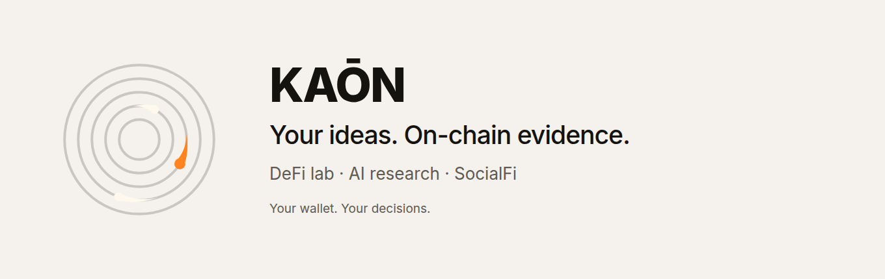

# KAŌN brand

**Your ideas. On-chain evidence.**

**DeFi lab · AI research · SocialFi**

KAŌN is a workspace to research crypto, test hypotheses and explore trading
strategies. Keep the evidence on your board. Share what holds up. Stay in control
of your wallet. [Full narrative and wording boundaries](NARRATIVE.md).

| Asset | Use |
| --- | --- |
| [KAON_Master.svg](KAON_Master.svg) | Original scalable orbital mark, transparent background. |
| [KAON_Etherscan_32.svg](KAON_Etherscan_32.svg) | Original 32 × 32 listing mark for Etherscan. |
| [KAON_CMC_200.png](KAON_CMC_200.png) | Original 200 × 200 listing mark for CoinMarketCap. |
| [kaon-logo-200.png](kaon-logo-200.png) | Existing public asset URL, preserved for integrations. |
| [kaon-workspace.svg](kaon-workspace.svg) | Current cream lockup with slogan and all three pillars. Uses Inter. |
| [kaon.png](kaon.png) | Current 1360 × 430 lockup, ready to share. |
| [kaon-og.png](kaon-og.png) · [SVG](kaon-og.svg) | Current 1200 × 630 social preview. |
| [Original supplied lockup](references/kaon-ai-research-original.png) | Historical reference with the previous “AI research for crypto” descriptor; use the current lockup for new material. |

App: https://app.kaon.global · Website: https://kaon.global

The name is **KAŌN**, including the macron. Keep the mark's proportions, neutral
orbital rings and orange accent. App identity: cream `#F5F2ED`, ink `#141310`,
Inter with JetBrains Mono for data. Publication of these assets is not a claim
that the application is open source or that DeFi actions are risk-free.
